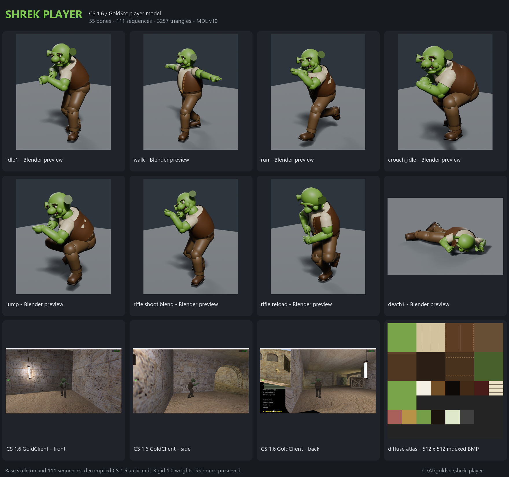

# Shrek Player for CS 1.6 / GoldSrc



A complete, skinned, animated Shrek player model for Counter-Strike 1.6 / GoldSrc.
It uses the stock CS 1.6 **arctic** skeleton and animation set, so every original
player sequence, hitbox, attachment and bone is preserved. The result is a normal
MDL v10 player model, not a static prop and not a Source-format asset.

**Current status:** compiled, independently inspected, strict player-compatibility
checked, round-trip imported, and load/render tested in a real CS 1.6 client.
Interactive movement animation was not reliably driven during the in-game test;
see [Validation](#validation).

---

## At a glance

| Item | Value |
|---|---|
| Compiled model | `models/player/shrek/shrek.mdl` |
| Format | GoldSrc MDL v10 (`IDST`, version 10) |
| Size | 2,451,200 bytes |
| Skeleton | 55 bones, exact arctic names and order |
| Sequences | 111, exact arctic names/order, 3,752 frames total |
| Geometry | 1,959 compiled vertices, 1,346 normals, **3,257 triangles** |
| Rigging | Rigid GoldSrc weights: one bone per vertex, weight 1.0 |
| Texture | 512 x 512, 8-bit indexed BMP, 31 used colours, no PBR |
| Bodyparts | 1 (`body`), backpack omitted |
| Hitboxes | 21, copied exactly from the baseline |
| Attachments | 2 (`Bip01 R Hand`, `Bip01 L Hand`) |
| Controller | 4 (`Bone01`, ZR 0..30) |
| Bounding box | -16..16 x -16..16 x 0..72; eye position 0,0,64 |
| Source basis | `E:\goldsrc\decomp_models\arctic.mdl` / `arctic.qc` / `arctic.smd` |

The baseline decompiled files were treated as read-only. All work copies live in
this project directory.

---

## Deliverables

| Path | Contents |
|---|---|
| `models/player/shrek/shrek.mdl` | Final compiled player model |
| `models/player/shrek/shrek.bmp` | Final 512 x 512 indexed diffuse texture |
| `shrek_player.blend` | Blender 5.2 scene: rig, skinned mesh, 11 representative actions, hidden arctic reference, preview camera/lights |
| `textures/shrek.bmp` | Canonical copy of the compiled diffuse texture |
| `textures/shrek_atlas.png` | RGB atlas preview |
| `source/shrek.qc` | Project QC using `$cd "anims"` / `$cdtexture "../textures"` |
| `source/shrek_final.qc` | Flat-path QC used for the final compile |
| `source/anims/shrek_body.smd` | Final body SMD in exact arctic node order |
| `source/anims/` | Reference animation SMDs copied from the decompile |
| `source/reference/` | Read-only copies of `arctic.mdl`, `arctic.qc`, `arctic.smd` and BMPs |
| `source/build_shrek.py` | Procedural mesh builder |
| `source/make_qc.py` | QC generator (111 sequences / 21 hitboxes) |
| `source/make_texture.py` | Atlas and indexed BMP generator |
| `source/verify_roundtrip.py` | Independent MDL round-trip import check |
| `source/make_contact_sheet.py` | Render contact-sheet builder |
| `reports/final_validation.md` | Full technical validation report |
| `reports/final_compile.log` | StudioMDL output |
| `reports/final_inspect_delivery.json` | Independent inspection of the shipped MDL |
| `reports/final_compatibility_delivery.json` | Strict player compatibility result |
| `reports/animation_diff_vs_official.json` | Per-sequence channel comparison vs official arctic |
| `reports/final_roundtrip_delivery.json` | Round-trip import evidence |
| `reports/checksums.sha256` | SHA-256 checksums |
| `renders/final_contact_sheet.png` | Final labelled contact sheet |
| `renders/` | Blender poses and CS 1.6 in-game captures |

`work/` contains staging, scratch renders and client backups. It is not required
to install the model; it is kept for reproducibility and rollback.

---

## Installation in CS 1.6

The model was tested by replacing team player models client-side. **Back up every
file you replace.** Paths below use the tested GoldClient installation; substitute
your own game directory for a Steam or retail install.

Tested root: `E:\CS 1.6 GoldClient`

### Option A - replace CT and T team models (tested method)

CS 1.6 selects player models by team folder. To make CTs and Ts use Shrek, replace
the MDL in the team folder and keep a copy of `shrek.bmp` beside it.

Example for the default CT model **urban**:

```powershell
$game = "E:\CS 1.6 GoldClient"
$src  = "C:\AI\goldsrc\shrek_player\models\player\shrek"

Copy-Item "$game\cstrike\models\player\urban\urban.mdl" `
          "$game\cstrike\models\player\urban\urban.mdl.bak"

Copy-Item "$src\shrek.mdl" `
          "$game\cstrike\models\player\urban\urban.mdl" -Force
Copy-Item "$src\shrek.bmp" `
          "$game\cstrike\models\player\urban\shrek.bmp" -Force
```

Example for the default T model **terror**:

```powershell
Copy-Item "$game\cstrike\models\player\terror\terror.mdl" `
          "$game\cstrike\models\player\terror\terror.mdl.bak"

Copy-Item "$src\shrek.mdl" `
          "$game\cstrike\models\player\terror\terror.mdl" -Force
Copy-Item "$src\shrek.bmp" `
          "$game\cstrike\models\player\terror\shrek.bmp" -Force
```

To replace **every** stock team selection, repeat for:

- **CT:** `urban`, `sas`, `gign`, `gsg9`
- **T:** `terror`, `leet`, `arctic`, `guerilla`
- **VIP:** `vip`

The compiled MDL embeds its 512 x 512 texture, so the model is self-contained.
`shrek.bmp` is still copied into the folder for tools and for clients/servers that
prefer an external texture.

If your client has HD player models, repeat the same replacement under:

```
<game>\cstrike_hd\models\player\<team>\<team>.mdl
```

The tested GoldClient has both `cstrike` and `cstrike_hd` player trees.

### Option B - keep the `shrek` folder and set it with a plugin

1. Copy the whole folder `models/player/shrek/` to
   `<game>\cstrike\models\player\shrek\` (and to `cstrike_hd` if needed).
2. On a server with AMX Mod X and the CSX module, set the player model with
   `cs_set_user_model(id, "shrek")`, and reset with `cs_reset_user_model(id)`.
3. Clients normally need the model files installed locally; automatic download
   depends on server settings and is not guaranteed.

This plugin route is optional and was not part of the in-game test. Option A is
the method that was actually verified.

### Uninstall

Restore each `*.mdl.bak` over the replaced `*.mdl`, or copy your original team
models back from `work/client_backup/`. Remove the extra `shrek.bmp` files if
desired.

---

## Validation

| Check | Result |
|---|---|
| StudioMDL compile | **PASS** - MDL v10, 2,451,200 bytes |
| Independent inspection | **PASS** - 55 bones, 111 sequences, 21 hitboxes, 1 `body` bodypart, 2 attachments, 1 texture |
| Strict player compatibility | **PASS** - 0 issues; only three `linear_movement` metadata differences (about 3%) |
| Sequence names/order | **PASS** - all 111 names and order match baseline (including 8 intentional duplicate dual-pistol names) |
| Bone names/order | **PASS** - exact 55-bone ordered prefix |
| Hitboxes / attachments / controller | **PASS** - exact baseline values |
| Rigid weights | **PASS** - 0 unweighted, 0 multi-weighted, 0 weights other than 1.0 |
| Animation channels vs official arctic | **PASS** - max position difference 0.003906 units (1/256), max rotation difference 0.0000963 rad |
| Round-trip import | **PASS** - 55 bones, 1,959 verts, 3,257 tris, 639 generated actions, 512 x 512 packed texture |
| CS 1.6 in-game load/render | **PASS** - Shrek rendered in the real GoldClient engine on `de_dust2` |
| CS 1.6 interactive animation | **NOT VERIFIED** - synthetic input could not reliably close the menu / drive movement |

The in-game test replaced all 9 standard and 11 HD player MDLs temporarily. The
client was restored afterwards and all 20 restored files match their backup
SHA-256 hashes.

### Known notes

- **T-pose-ish arms in walk/run:** inherited from the base arctic lower-body
  sequences. CS 1.6 normally blends an aim layer over the upper body; the raw
  sequences show the reference arm pose. This is not a rig or mesh defect.
- **Duplicate sequence names:** the source arctic MDL contains two groups of
  eight identically named dual-pistol sequences (indices 23-30 and 66-73). The
  delivered MDL preserves those names and order exactly. The source SMD files
  use `_1` / `_2` suffixes only to disambiguate the files on disk.
- **Hidden bone-keeper triangles:** a few tiny triangles are hidden inside the
  body at unused helper bone heads so StudioMDL does not prune the exact
  55-bone skeleton. They are not visible on the model.
- **Texture:** deliberately flat-shaded, 31-colour indexed atlas with stitched
  seams and dirt marks. No PBR, normal maps, or smooth gradients.
- **Compiler warning:** StudioMDL reports that `$cliptotextures` is ignored in
  this compiler version. This is non-fatal and does not affect the model.
- **Fan asset:** Shrek is a DreamWorks Animation property. This model is a
  non-commercial fan work and is not intended for resale.

---

## Rebuild notes

The final compile was performed with the bundled StudioMDL from GoldSrc Model
Toolchain 1.4.3, not with `export_selected_static` (that pipeline is for static
props). The flat build staging area remains at `work/final/build/`.

1. Rebuild the mesh with `source/build_shrek.py` on the modeling scene.
2. Export the body SMD in the **reference arctic node order**. The delivered
   `source/anims/shrek_body.smd` is that export; it must not be exported in
   Blender armature order.
3. Use `source/shrek_final.qc` as the QC. It references `shrek_body` and the 640
   copied animation SMDs, with 111 sequences and 21 hitboxes.
4. Compile in a flat folder containing the QC, the body SMD, all animation SMDs
   and `shrek.bmp`. `work/final/build/` is a working example.
5. Inspect with the Toolchain MDL inspector and run
   `validate_model_compatibility(candidate, baseline, "player")`.

The final project QC (`source/shrek.qc`) uses `$cd "anims"` and
`$cdtexture "../textures"`; the flat QC is the one used for the shipped build.

---

## Credits

- Base skeleton, animations, hitboxes and player conventions: CS 1.6 `arctic`
  player model (Valve / Sierra; decompiled source supplied by the user).
- Mesh, texture, rig transfer and QC: this project.
- Compiler: StudioMDL SC (Sven Co-op SDK modelling tools), via
  [GoldSrc Model Toolchain](https://github.com/XiangXtreme/goldsrc-model-toolchain).
- Shrek: DreamWorks Animation. Fan-made, non-commercial use.
